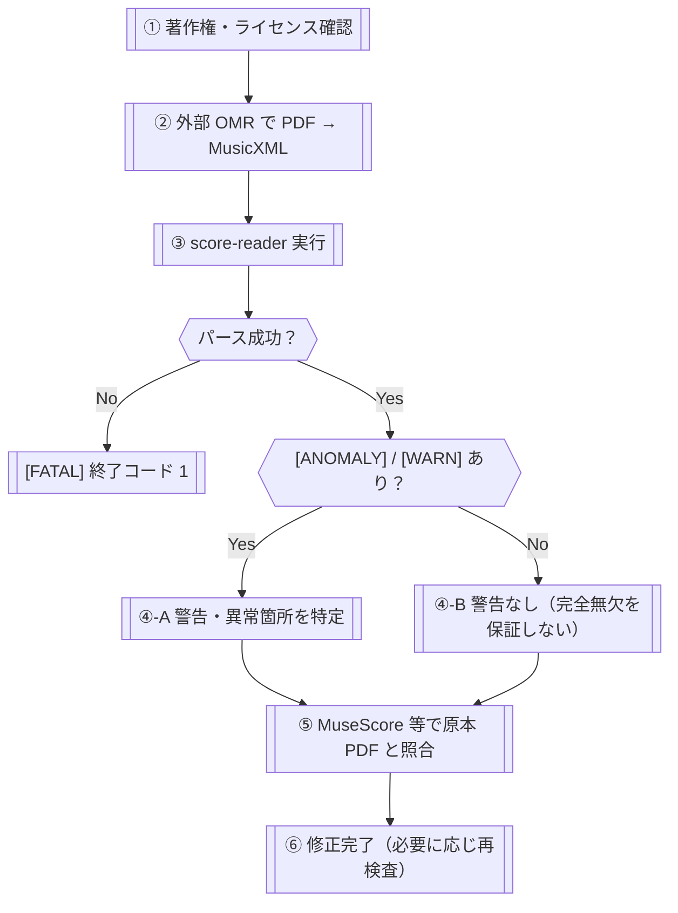

# UI and Flow Design（UI・フロー設計）

<details>
<summary>Document Info（文書情報）</summary>

<!-- Document Info（文書情報） -->

| Item（項目） | Value（値） |
|---|---|
| Document ID（文書ID） | UI-001 |
| Version（バージョン） | 0.3.9 |
| Status（ステータス） | Draft |
| Created Date（作成日） | 2026-06-09 |
| Last Updated（最終更新日） | 2026-11-01 |
| Owner（管理者） | Takashi Oikawa |
| Related Documents（関連文書） | [AGENTS.md](../../AGENTS.md) / README.md / 02_REQUIREMENTS_DEFINITION.md / 03_DATA_AND_SECURITY_DESIGN.md / 05_ARCHITECTURE_DESIGN.md / docs/reviews/2026-09-06_SCORE_READER_DESIGN_REVIEW.md |

</details>

---

## Table of Contents（目次）

1. [Purpose（目的）](#1-purpose目的)
2. [Scope（対象範囲）](#2-scope対象範囲)
3. [Out of Scope（対象外範囲）](#3-out-of-scope対象外範囲)
4. [Assumptions（前提条件）](#4-assumptions前提条件)
5. [Definition Details（定義内容）](#5-definition-details定義内容)
6. [Open Issues（未決事項）](#6-open-issues未決事項)
7. [Handoff to Detail Design（詳細設計への引き継ぎ）](#7-handoff-to-detail-design詳細設計への引き継ぎ)
8. [Change History（変更履歴）](#8-change-history変更履歴)

---

## 1. Purpose（目的）

**初回実装の承認（2026-11-01、ユーザー）**: 2入力、02 §5.8.3〜5.8.5の初回判定表に基づく対応・部分比較、P1/P2/P3/U、個別根拠を保持した集約、共通テストデータ保存、および15ケースの期待報告を初回範囲として承認した。3入力以上・一般の多声部対応・実 OMR 効果検証は未承認/未実施のまま維持する。本書の初回範囲はこの承認で確定し、範囲外の提案・ASKMEへ拡張しない。


本文書は**現行プロトタイプ**における `verify_score.py`（単一 MusicXML 構造検査の検証実装）の CLI 操作フロー・出力確認フロー・人間レビューフローを定義し、実装・運用フェーズの基準とすることを目的とする。

開発段階の境界は `01_REQUEST_DEFINITION.md` §2 Development Stage Classification を参照する。現行は CLI である。本実装確定スコープ（`02_REQUIREMENTS_DEFINITION.md` §5.8）の CLI フロー詳細は、本文書の Open Issues（TBD-001）で管理する。比較機能の実装可否は確定済みである。最終的な正確性の担保は人間による原本 PDF 照合で行う。本文書の対象読者は、設計者・実装者・利用者・プロジェクトオーナーである。

---

## 2. Scope（対象範囲）

本書の初回承認範囲を本実装として扱い、その他の提案は未承認のまま区別する。§5.1以降の既存プロトタイプの記録は凍結時点の仕様・制約である。

| 対象 | 内容 |
|---|---|
| CLI インターフェース | コマンドライン引数・実行コマンド・出力形式の選択 |
| ユーザー操作フロー | 著作権確認 → 外部 OMR 実行 → score-reader 実行 → 出力確認 → 人間レビュー |
| 出力確認フロー | テキスト出力・JSON 出力の読み取り方・警告・異常の判断方針 |
| 人間レビューフロー | score-reader 出力を受けた後、MuseScore 等で原本 PDF と照合する作業フロー |
| エラー・警告処理フロー | `[FATAL]` / `[ANOMALY]` / `[WARN]` の対処フロー |
| 著作権・ライセンス確認フロー | 外部 OMR サービス利用前・テスト素材追加前の確認手順 |

---

## 3. Out of Scope（対象外範囲）

| 対象外項目 | 理由 |
|---|---|
| GUI 画面設計・ワイヤーフレーム | score-reader は CLI ツールであり、画面を持たない |
| Web UI・モバイル UI | プロトタイプ検証段階は CLI のみ対象とする |
| 原本PDF横並び画面 | 本リポジトリの対象外。境界は `01_REQUEST_DEFINITION.md` §2 Development Stage Classification を参照する |
| MusicXML 自動修正 UI | 将来検討事項。score-reader は検査結果の出力のみ |
| 外部 OMR サービスの操作 UI | score-reader のスコープ外 |
| 完全自動化フロー（人間確認を省略するフロー） | 設計原則に反する |

---

## 4. Assumptions（前提条件）

本文書の内容が成立するために必要な前提は `01_REQUEST_DEFINITION.md` §4 を継承する。以下は UI・フロー設計フェーズで追加する前提を示す。

- 利用者は Python 実行環境・仮想環境のセットアップが完了していること（環境構築手順は `06_OPERATION_AND_HANDOFF.md` に記載）
- 利用者は MuseScore 等の楽譜編集ソフトを別途用意し、原本 PDF との照合を行う意図があること
- score-reader の CLI 出力は「確認対象情報」であり、正解として採用しないこと
- ライセンス構成の決定記録は `03_DATA_AND_SECURITY_DESIGN.md` TBD-004 を参照する

---

## 5. Definition Details（定義内容）

### 5.1 Screen List — Detail Definition（画面一覧・詳細定義）

プロトタイプ検証段階は GUI を持たないため、画面一覧は対象外とする。代わりに CLI インターフェース仕様を定義する。

| Screen ID（画面ID） | Screen Name（画面名） | Input Items（入力項目） | Output Items（出力項目） | Main Operations（主要操作） | Notes（備考） |
|---|---|---|---|---|---|
| CLI-001 | verify_score.py 実行 | 第 1 引数: MusicXML ファイルパス。任意: `--json` | 標準出力: 検査結果（テキスト or JSON）。終了コード 0/1 | 検査実行・出力確認 | 実行ファイル: `prototype/src/verify_score.py` |

#### 引数・フラグ

| 引数 / フラグ | 必須 | 内容 |
|---|---|---|
| `input`（第 1 引数） | 必須 | 検査対象 MusicXML ファイルパス |
| `--json` | 任意 | パース成功時、JSON 形式で標準出力 |

#### 実行コマンド例

```bash
python3 verify_score.py ../tests/<file>.musicxml
python3 verify_score.py ../tests/<file>.musicxml --json
python3 verify_score.py ../tests/<file>.musicxml --json > result.json
```

現行実装では、`--json` 指定時でも入力のパースに失敗すると JSON ではなくプレーンテキストの `[FATAL]` が標準出力へ出る。リダイレクト先にも JSON は書き込まれない。将来の JSON エラー形式は未確定である（`02_REQUIREMENTS_DEFINITION.md` §5.7 FUT-002）。

### 5.2 Screen Transition and Business Flow（画面遷移図・業務フロー）

画面遷移は対象外（CLI ツールのため）。業務フロー全体を以下に示す。



| 事項 | 内容 |
|---|---|
| 完全自動化禁止 | 人間確認を省略して完了する分岐を設けない |
| 警告なし≠正確 | `[WARN]` / `[ANOMALY]` 0 件でも原本 PDF 照合（⑤）を省略しない |
| OMR 出力は確認対象 | ② の MusicXML を正解として扱わない |
| パース失敗時の `--json` | 現行は JSON にならない。プレーンテキスト `[FATAL]` |

### 5.3 Wireframes and Layout Policy（主要画面のワイヤーフレーム・レイアウト方針）

本文書では対象外。理由: プロトタイプ検証段階は CLI ツールであり、画面・レイアウトを持たない。原本PDF横並び画面は本リポジトリの対象外である（`01_REQUEST_DEFINITION.md` §2 Development Stage Classification 参照）。

### 5.4 Operation Flow and User Scenarios（操作フロー・ユーザーシナリオ）

要求定義の成功基準 ID（`01_REQUEST_DEFINITION.md` SC-001〜SC-009）と混同しないため、操作シナリオ ID は `FLOW-` を用いる。

| Scenario ID（シナリオID） | Operation Name（操作名） | Steps（操作手順） |
|---|---|---|
| FLOW-001 | 基本検査フロー（テキスト出力） | 1. リポジトリルートで仮想環境を有効化 → 2. `cd prototype/src` → 3. `python3 verify_score.py ../tests/<file>.musicxml` → 4. 出力の `[ANOMALY]` / `[WARN]` を記録 → 5. MuseScore 等で原本 PDF と照合 |
| FLOW-002 | JSON 出力フロー | 1. FLOW-001 と同様の前提 → 2. `--json` 指定で実行 → 3. パース成功時のみ JSON になる。パース失敗時はプレーンテキスト `[FATAL]` → 4. 必要に応じリダイレクトで保存 → 5. 後工程または照合作業で参照 |
| FLOW-003 | 入力ファイル選択フロー | 1. 著作権状況を確認（楽曲の権利、MusicXML エンコーディングの権利、加工・再配布条件を分離） → 2. 外部 OMR 出力 MusicXML を用意 → 3. ファイルパスを第 1 引数に指定 |
| FLOW-004 | 出力確認フロー | 1. `[FATAL]`: OMR 再実行または形式確認。`--json` 指定でも現行は JSON にならない → 2. `[ANOMALY]`: 該当小節を最優先照合 → 3. `[WARN]`: リストアップして原本 PDF 照合 → 4. 警告 0 件: 完全無欠を保証しない旨を確認し照合を省略しない |
| FLOW-005 | 人間レビューフロー | 1. 警告・異常箇所を整理 → 2. MuseScore で MusicXML を開く → 3. 原本 PDF と目視照合・修正 → 4. 必要に応じ score-reader を再実行 |

#### 著作権確認チェック（FLOW-003 補足）

```
□ 対象楽譜の著作権状況を確認した
□ MusicXML エンコーディングの権利・利用条件を確認した
□ 外部 OMR サービスの利用規約を確認した
□ テスト素材追加時は楽曲の権利、エンコーディング、加工・再配布条件を分けて確認した
```

### 5.5 Validation and Error Handling Policy（バリデーション・エラーハンドリング方針 / UI層）

| Target（対象） | Validation Rules（バリデーションルール） | Error Message / Display Policy（エラーメッセージ・表示方針） |
|---|---|---|
| 入力ファイルパス | ファイルが存在し、`music21.converter.parse` が読み込める形式であること | パース失敗: プレーンテキスト `[FATAL]` を標準出力へ出し終了コード 1。`--json` 指定時も現行は JSON にならない |
| `--json` フラグ | 指定・未指定いずれも有効 | 無効なフラグ: `argparse` 標準エラー |

| 出力レベル | 利用者の対処フロー |
|---|---|
| `[FATAL]` | OMR 再実行・MusicXML 形式確認・手動対応を検討 |
| `[ANOMALY]` | 該当小節を最優先で原本 PDF 照合 |
| `[WARN]` | 警告箇所をリストアップし原本 PDF 照合 |
| `[INFO]` | 必要に応じて確認 |
| 警告・異常なし | 原本 PDF 照合を省略しない |

### 5.6 Accessibility and Responsive Design Policy（アクセシビリティ・レスポンシブ対応方針）

本文書では対象外。理由: プロトタイプ検証段階は CLI ツールであり、GUI・画面を持たない。

### 5.7 Review Information Proposal（確認情報の表示・優先順位案）

本節は表示意図の説明例であり、初回の実際のCLI形式は§5.8、順位の確定仕様は§5.7.1に示す。採用済みの表示要件は `02_REQUIREMENTS_DEFINITION.md` CMP-002〜CMP-005、保持情報の案は `03_DATA_AND_SECURITY_DESIGN.md` §5.7 を参照する。表示ラベル・段階名・並び順は本書 TBD-001 / TBD-002 で決定する。

#### 確認情報の表示例（架空の入力による説明）

```text
場所: 入力 A / パート P1 / 譜表 1 / 声部 1 / 小節番号 12（出現順 13）/ 小節先頭から四分音符 1 個分
対応先: 入力 B / パート P1 / 譜表 1 / 声部 1 / 小節番号 12（出現順 13）/ 同位置
差分: 記音 A=C4、B=D4。音価は同じ。各小節の拍数合計は正常。
確認理由: 音高の入力間差分。個別の理由と入力元を保持。
優先順位: P2（内容差）
原本で確認する事項: 該当音の符頭位置、調号・臨時記号、移調指定。
原本 PDF のページ位置: 不明（位置情報なし）
注記: A/B のどちらが正しいかは判定していない。
```

```text
場所: 入力 A / パート P1 / 小節番号 12（出現順 13）
対応先: 入力 B / 小節番号 12 が複数存在。対応未確定。
差分: 算出不能（比較不能を差分なしとは扱わない）
確認理由: 小節対応が一意に成立しない。各候補の局所位置と個別根拠を別に表示。
優先順位: P1（対応不成立）
原本で確認する事項: 小節の並び・欠落・重複と各入力の対応。
原本 PDF のページ位置: 不明。推測によるページ案内はしない。
```

位置の一部だけが分かる場合は判明部分と不明部分を併記する。複数警告が同一箇所に集約された場合は、一覧の場所はまとめても、検査ごとの理由・観測値・出典を全て辿れる構成とする。色や別画面を前提にせず、テキスト / JSON の標準出力で確認できる案を推奨する。

#### 優先順位の基準案（TBD-002）

推奨案は「他の比較を妨げる対応不成立」「構造検査や入力間差分の確認」「既知の検査限界・高リスク記譜の確認」を材料に確認順を付ける方法である。高リスク記譜の候補は多声部、移調、タイ・連符・装飾音等であり、対象一覧・検出方法は `02_REQUIREMENTS_DEFINITION.md` TBD-003 / TBD-006 の判断を要する。この列挙順を優先順位の確定値とはしない。

- 対応不成立を先に確認する案の理由は、誤った位置対応により後続の比較結果を誤解するのを防ぐためである。
- 複数 OMR の一致だけで一律に順位を下げない。検査可能性・記譜の複雑さ・残存する確認理由も併せて扱う。
- 検査レベル（現行の WARN / ANOMALY 等）、比較状態、確認順位を別に表示する案とする。現行 FLOW-004 の運用を本実装の順位表へそのまま転用しない。
- 集約結果には各理由の順位根拠を残す。代表順位と順位不明の配置は §5.7.1 の初回確定仕様で定義し、同順位内の技術的な並べ方は Work が定義する。
- 低優先・順位不明も一覧から削除しない。数値確率や「正解」の表示には変換しない。

#### 5.7.1 Priority Decision Table（初回確認順の確定仕様）

TBD-002 の初回範囲として2026-11-01に次の区分を承認。数字は誤りの確率ではなく確認順である。順位は理由に基づき、位置が不明であることだけでは U にしない。

| 区分 | 条件 | 例 |
|---|---|---|
| P1：比較の前提確認 | 対応付けや時間軸の不成立が複数の後続比較を妨げる | 小節欠落の疑い、番号重複、同名パートを一意に対応できない、開始位置が解釈不能 |
| P2：内容・限定範囲の確認 | 局所的な音高・音価・種類・和音差、または対象軸の比較不能理由が特定できる | 音高差、休符置換、移調情報不明による実音のみ不能、タイの接続解釈が初回対象外 |
| P3：記譜表示の確認 | 対応する音の意味は比較できて一致しているが、確認すべき表示差が残る | 音高が同じで臨時記号の表示だけ異なる。確認対象として残す |
| U：順位不明 | 確認対象であることは分かるが、理由・影響範囲が不足し P1〜P3 に分類できない | 未分類の解析結果。分かる位置と分類不能理由を表示 |

表示順は U（独立した先頭枠）→P1→P2→P3 とする。U を低優先へ補完しないためであり、P1より誤りらしいという意味ではない。高リスク記譜の存在だけ、または比較範囲内での一致だけは優先順位付き警告にせず、検査範囲・存在情報として別に記録する。未対応なら存在ではなく「どの軸を検査できなかったか」を理由として P2、時間軸や対応の破綻へ波及するなら P1 とする。

集約対象が同じ場合、個別理由を保持したまま、既知の順位の最上位（P1→P2→P3）を代表順位とする。U が一つでも含まれる場合は表示枠を U にし、「既知理由の代表=P2、順位不明の理由あり」のように両方を残す。全てUなら代表もU。全て存在情報のみなら、集約しても警告へ昇格させない。

同順位内は Work の実装規則として、入力の指定順→パート出現順→譜表→声部→小節出現順→小節内位置→理由識別子の順で安定して並べる。各要素の不明値はその要素の末尾とし、同値なら元要素の出現順を用いる。これは意味上の優先度を変えない技術的な並べ方であり、別の承認事項にしない。

**高リスク記譜の表示例**: 「連符あり」は存在情報。「連符の持続時間の解釈は初回対象外。音価を比較できない」は確認理由。「タイあり」だけで P1 にしない。初回でタイ・連符の意味解釈を保留しても、独立に解釈できる通常音符の結果を残す。存在を正常の保証にも異常の断定にも使わない。

### 5.8 Initial Comparison CLI（初回本実装の操作）

リポジトリルートから `PYTHONPATH=src python3 -m score_reader INPUT_A INPUT_B [--json]` を実行する。2つの位置引数は必須で、3入力以上や不足は引数エラー。`--help`で説明を表示する。入力形式は非圧縮score-partwise。DTD/entity宣言、score-timewise、圧縮ファイルは読取不能を明示する。

標準はテキスト。優先順位順の確認一覧に場所・差分・理由・原本で確認する事項を表示し、続けて全出典・比較軸・検査限界を表示する。`--json`は03 §5.9のレポート1個。テキストも同じ全情報を持ち、情報不足を別形式で補わせない。位置不明はnull/不明、Uを先頭の別枠とする。PDFページを推測しない。

終了コードは、レポート作成できた場合0（partialや差分ありを含む）、入力読取不能1、引数不正2。0は正確性や全軸比較成功を意味しない。入力不能はJSONでもJSONのerrorsに記録する。引数誤りは標準エラー出力の使用法で案内する。凍結中の `python3 prototype/src/verify_score.py FILE [--json]` の呼出し・出力は従来どおり。

例: SYN-002ではP1/譜表1/声部1/第2小節/位置1にP2を1箇所表示し、written_pitch.diffとsounding_pitch.diffを両方保持する。SYN-006では小節1のみ比較し、残りをP1として確認案内する。SYN-011では実音不能P2と、比較できた記音・音価の一致を併記する。

---

## 6. Open Issues（未決事項）

| ID | Open Issue（未決事項） | Owner（担当者） | Due Date（期限） | Status（ステータス） |
|---|---|---|---|---|
| TBD-001 | 初回は2位置引数と--json、同じレポート情報をテキスト/JSONへ出す。具体仕様は§5.8。初回外のPDF位置入力・既存JSON移行等は未決。 | Takashi Oikawa | 初回外の着手前 | 初回承認・残範囲ASKME |
| TBD-002 | §5.7.1のP1/P2/P3/U・U先頭別枠・個別理由を保持した代表順位を2026-11-01承認。 | Takashi Oikawa | 初回外の着手前 | 初回Resolved |
| TBD-003 | 著作権確認チェックリストを正式化・運用化するか。 | Takashi Oikawa | 未定 | Open |

凍結プロトタイプへのJSONエラー形式変更は `02_REQUIREMENTS_DEFINITION.md` §5.7 FUT-002 で未決。別配置の初回本実装は§5.8に従う。

---

## 7. Handoff to Detail Design（詳細設計への引き継ぎ）

以下は凍結プロトタイプの引き継ぎ。新しい比較CLIの引数・終了コード・JSONは§5.8を参照する。

1. **「警告なし＝正確」の誤解防止**: `[WARN]` / `[ANOMALY]` 0 件でも「完全無欠を保証しない」注記を必ず出力に含めること。
2. **終了コードの徹底**: パース成功 0、パース失敗 1。
3. **CLI 引数変更時は本文書を更新**: 引数・フラグ追加時は §5.1 と FLOW シナリオを更新すること。
4. **著作権確認フローの周知**: 利用者向けドキュメントに実行前の著作権確認を明示すること。
5. **`--json` 時のパース失敗**: 現行は JSON にならない。将来形式は未確定であり、決定済みとして記載しない。

---

## 8. Change History（変更履歴）

| Version（バージョン） | Date（日付） | Changes（変更内容） | Author（変更者） |
|---|---|---|---|
| 0.1 | 2026-06-09 | 初版作成 | Takashi Oikawa |
| 0.2 | 2026-06-28 | 正本記入・開発段階分類表記統一 | Takashi Oikawa |
| 0.3 | 2026-09-06 | 設計レビュー反映。分離ライセンス構成へ修正。操作シナリオ ID を FLOW-001〜FLOW-005 に変更。`--json` 時のパース失敗が非 JSON である現行制約を明記 | Takashi Oikawa |
| 0.3.1 | 2026-09-06 | 設計レビュー差し戻し反映。複数 MusicXML 比較を本実装確定スコープとし、CLI フロー詳細のみ TBD-001 に残す。Web UI は将来検討のまま | Takashi Oikawa |
| 0.3.2 | 2026-09-06 | 文書表現の整理。CLI 現行・Web UI 将来検討・複数 MusicXML 比較の本実装確定を維持。仕様の追加・変更は行っていない | Takashi Oikawa |
| 0.3.3 | 2026-09-06 | 原本 PDF 横並び画面を将来検討事項から外し、本リポジトリでは設計・実装方針を定義しない対象へ変更。人間が MuseScore 等で原本 PDF と目視照合する既存運用は維持する | Takashi Oikawa |
| 0.3.4 | 2026-09-06 | 日本語表現の明確化。仕様・設計判断の変更なし | Takashi Oikawa |
| 0.3.5 | 2026-10-02 | 文書間重複を整理し、正本参照へ統一。仕様変更なし | Takashi Oikawa |
| 0.3.6 | 2026-11-01 | 作業ルールの移行先 AGENTS.md を関連文書に追加。仕様・設計判断の変更なし | Work |
| 0.3.7 | 2026-11-01 | 確認情報の表示例と優先順位案を追加。既存 CLI・互換性・順位の ASKME を詳細化。 現行プロトタイプは変更なし。 | Work |
| 0.3.8 | 2026-11-01 | 優先順位・順位不明・集約の判定案、高リスク記譜の存在と確認理由の分離を具体化。 設計のみ更新し、データ作成・コード実装は未実施。 | Work |
| 0.3.9 | 2026-11-01 | 初回2入力仕様と15人工ケースのユーザー承認を反映。本実装・共通データ・再現可能な検証手順を追加。初回外のASKMEは保持。 | Work |
