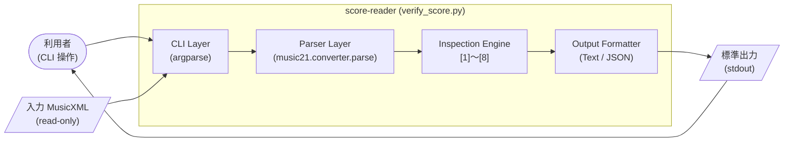
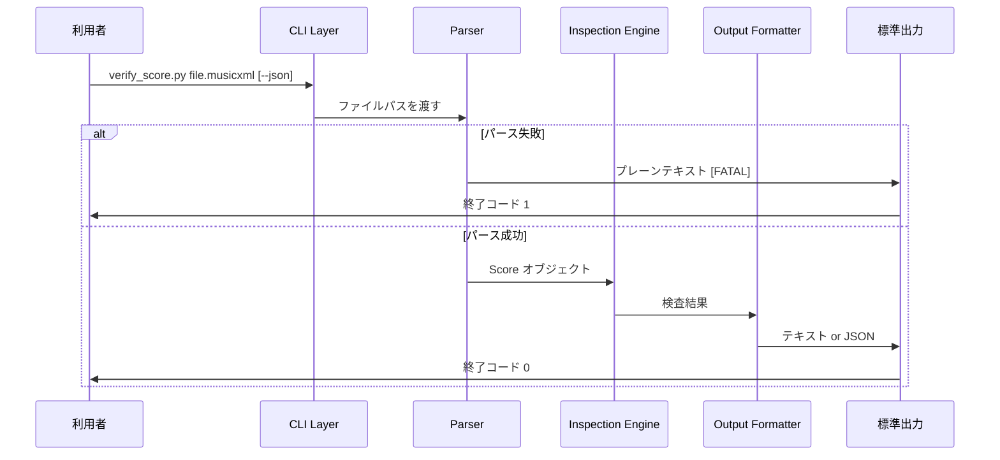

# Architecture Design（アーキテクチャ設計）

<details>
<summary>Document Info（文書情報）</summary>

<!-- Document Info（文書情報） -->

| Item（項目） | Value（値） |
|---|---|
| Document ID（文書ID） | ARCH-001 |
| Version（バージョン） | 0.3.10 |
| Status（ステータス） | Draft |
| Created Date（作成日） | 2026-06-09 |
| Last Updated（最終更新日） | 2026-11-01 |
| Owner（管理者） | Takashi Oikawa |
| Related Documents（関連文書） | [AGENTS.md](../../AGENTS.md) / README.md / 02_REQUIREMENTS_DEFINITION.md / 03_DATA_AND_SECURITY_DESIGN.md / 04_UI_AND_FLOW_DESIGN.md / 06_OPERATION_AND_HANDOFF.md / docs/reviews/2026-09-06_SCORE_READER_DESIGN_REVIEW.md / docs/reviews/2026-09-06_SCORE_READER_CROSS_DOCUMENT_REVIEW.md |

</details>

---

## Table of Contents（目次）

1. [Purpose（目的）](#1-purpose目的)
2. [Scope（対象範囲）](#2-scope対象範囲)
3. [Out of Scope（対象外範囲）](#3-out-of-scope対象外範囲)
4. [Assumptions（前提条件）](#4-assumptions前提条件)
5. [Definition Details（定義内容）](#5-definition-details定義内容)
6. [Open Issues（未決事項）](#6-open-issues未決事項)
7. [Handoff to Detail Design（詳細設計への引き継ぎ）](#7-handoff-to-detail-design詳細設計への引き継ぎ)
8. [Change History（変更履歴）](#8-change-history変更履歴)

---

## 1. Purpose（目的）

**初回実装の承認（2026-11-01、ユーザー）**: 2入力、02 §5.8.3〜5.8.5の初回判定表に基づく対応・部分比較、P1/P2/P3/U、個別根拠を保持した集約、共通テストデータ保存、および15ケースの期待報告を初回範囲として承認した。3入力以上・一般の多声部対応・実 OMR 効果検証は未承認/未実施のまま維持する。本書の初回範囲はこの承認で確定し、範囲外の提案・ASKMEへ拡張しない。


本文書は**現行プロトタイプ**における `verify_score.py`（単一 MusicXML 構造検査の検証実装）のシステム構成・技術スタック・処理フロー・アーキテクチャ制約を定義し、実装フェーズの基準とすることを目的とする。

開発段階の境界は `01_REQUEST_DEFINITION.md` §2 Development Stage Classification を参照する。本実装確定スコープ（`02_REQUIREMENTS_DEFINITION.md` §5.8）のアーキテクチャ詳細は、本文書の Open Issues（TBD-001）で管理する。比較機能の実装可否は確定済みである。プロトタイプアーキテクチャと本実装構想を混同しない。本文書の対象読者は、設計者・実装者・プロジェクトオーナーである。

---

## 2. Scope（対象範囲）

本書の初回承認範囲を本実装として扱い、その他の提案は未承認のまま区別する。§5.1以降の既存プロトタイプの記録は凍結時点の仕様・制約である。

| 対象 | 内容 |
|---|---|
| システム | score-reader プロトタイプ検証段階（`prototype/src/verify_score.py`） |
| 実行形態 | ローカル実行 CLI ツール（単一 Python スクリプト） |
| 処理対象 | 単一 MusicXML ファイルの内部整合性検査 |
| 出力 | 標準出力（テキスト形式 / JSON 形式） |
| 依存ライブラリ | `music21 10.3.0`（`prototype/requirements.txt` 参照） |

---

## 3. Out of Scope（対象外範囲）

| 対象外項目 | 理由 |
|---|---|
| 本番グレードのアーキテクチャ設計 | プロトタイプ検証段階を対象とする |
| データベース設計 | データを永続化しない |
| 複数 MusicXML の自動統合 | 自動修正、自動統合は将来検討事項。複数 MusicXML 比較自体は本実装確定スコープであり、アーキテクチャ詳細は本書 TBD-001 |
| MusicXML 自動修正パイプライン | 同上 |
| GUI・Web UI | 将来検討事項 |
| 原本PDF横並び画面 | 本リポジトリの対象外。境界は `01_REQUEST_DEFINITION.md` §2 Development Stage Classification を参照する |
| 外部 OMR サービス API 連携 | プロトタイプ検証段階では外部 API 連携を持たない（本書 TBD-003） |
| スケーリング・冗長化・クラウドデプロイ | ローカル実行ツールのためプロトタイプ検証段階では対象外 |

---

## 4. Assumptions（前提条件）

本文書の内容が成立するために必要な前提は `01_REQUEST_DEFINITION.md` §4 を継承する。以下はアーキテクチャ設計フェーズで追加する前提を示す。

**Prototype の境界**

- `verify_score.py` は Prototype / 技術検証用であり、正式完成版ではない
- プロトタイプの設計は「現技術で検出できることを最小限の構成で実現する」ことを優先する
- 現行プロトタイプは凍結中である

**アーキテクチャ制約**

- 依存ライブラリは `music21 10.3.0` のみ
- 入力は 1 実行 = 1 MusicXML ファイル
- 出力は標準出力のみ。入力ファイルを変更しない（非破壊）
- 音高・音価・声部の正誤を自動判定しない
- `[WARN]` / `[ANOMALY]` 0 件であっても完全無欠を保証しない

---

## 5. Definition Details（定義内容）

### 5.1 System Architecture Diagram（システム構成図）



#### 処理フロー（Processing Flow）



`--json` 指定時でも、パース失敗時の現行出力は JSON ではない。将来の JSON エラー形式は `02_REQUIREMENTS_DEFINITION.md` §5.7 FUT-002 で未確定である。

### 5.2 Technology Stack and Rationale（技術スタック・採用理由）

| Type（種別） | Technology（採用技術） | Version（バージョン） | Rationale（採用理由） |
|---|---|---|---|
| Language（言語） | Python | 3.x | music21 が Python で提供される。プロトタイプ実装の生産性が高い |
| Library（ライブラリ） | music21 ソフトウェア本体 | 10.3.0 | MusicXML 構造化読み取りに成熟した OSS。ソフトウェア本体のライセンスは BSD-3-Clause。corpus 内エンコーディングの利用条件はソフトウェア本体のライセンスとは別である |
| CLI Parsing | argparse | Python 3.x 同梱 | 外部依存を増やさず `--json` を処理 |
| Framework（フレームワーク） | なし | — | プロトタイプ検証段階は単一スクリプト構成 |
| Database（DB） | なし | — | データを永続化しない |
| Infrastructure（インフラ） | ローカル Python 仮想環境 | `.venv` | プロトタイプ検証段階ではクラウド・コンテナ不要 |
| Package Management | pip + requirements.txt | — | `prototype/requirements.txt` で依存を固定 |

### 5.3 Module Structure and Layer Design（モジュール構成・レイヤー設計）

プロトタイプ検証段階は単一スクリプト（`verify_score.py`）で全機能を実装する。

```
prototype/
├── src/
│   └── verify_score.py
├── tests/
│   └── *.musicxml
└── requirements.txt
```

| コンポーネント | 責務 |
|---|---|
| CLI Layer | 引数解析・出力形式選択 |
| Parser Layer | MusicXML 読み込み。失敗時はプレーンテキスト `[FATAL]`・終了コード 1 |
| Inspection Engine | 検査 [1]〜[8]。推測しない・断定しない |
| Output Formatter | テキスト/JSON 出力。「完全無欠を保証しない」注記を含める |

#### 検査エンジン（Inspection Engine）

| 検査 ID | 機能 | 参照範囲 | 判定しないこと |
|---|---|---|---|
| [1] 移調楽器 | 移調情報の報告 | 全パート | 正誤の確定 |
| [2] 小節長 | 拍子との不一致検出 | 全パート・全小節 | どちらが正しいか |
| [3] 調号 | 調号の列挙 | `02_REQUIREMENTS_DEFINITION.md` FR-004 | 調号の正誤 |
| [4] テンポ/拍子 | 変化イベントの列挙 | `02_REQUIREMENTS_DEFINITION.md` FR-005 | テンポの正誤 |
| [5] Unpitched（無音高） | `Unpitched` 件数 | 全パート | 完全無欠の保証 |
| [6] リハーサルマーク | 小節対応の列挙 | 全パート | マークの正誤 |
| [7] 和音音数 | 構成音数分布の報告 | 全パート | 何音であるべきか |
| [8] パート間小節数 | 小節数一致・不一致 | 全パート | どのパートが正しいか |

検査[3][4]の第1パート制約および関連未決事項は `02_REQUIREMENTS_DEFINITION.md` を参照する。

### 5.4 External Integration and API Design（外部システム連携・API設計方針）

プロトタイプ検証段階では外部公開 API を持たない。

| Integration Target / API Name（連携先 / API名） | Method（連携方式） | Purpose / Overview（用途・概要） |
|---|---|---|
| music21 | pip パッケージ | MusicXML 構造化読み取り |
| ローカルファイルシステム | OS ファイルアクセス | 入力 MusicXML 読み取り（read-only） |
| 標準出力 | print / json.dumps | 検査結果出力 |
| 外部 OMR サービス | score-reader スコープ外 | 利用者が PDF → MusicXML を取得 |

本実装確定スコープ: `02_REQUIREMENTS_DEFINITION.md` §5.8。アーキテクチャ詳細は本書 TBD-001。将来検討事項および本リポジトリの対象外は `01_REQUEST_DEFINITION.md` §2 Development Stage Classification を参照する。外部 OMR API 連携は本書 TBD-003。

### 5.5 Scalability and Fault Tolerance（スケーラビリティ方針・障害対策）

本節は現在のリスク対策表である。詳細設計への引き継ぎ節（§7）ではない。

| Aspect（観点） | Design Details（設計内容） |
|---|---|
| Scaling Policy（スケーリング方針） | プロトタイプ検証段階では対象外。ローカル実行ツール |
| Redundancy（冗長化） | プロトタイプ検証段階では対象外 |
| Failover（フェイルオーバー） | パース失敗時はプレーンテキスト `[FATAL]` 出力・終了コード 1 |
| Other Fault Tolerance（その他耐障害設計） | 入力ファイルの非破壊アクセス。警告 0 件時も注記を出力して誤解を防止 |

#### アーキテクチャリスク

| リスク | 対策方針 |
|---|---|
| music21 バージョン非互換 | `requirements.txt` で `10.3.0` に固定。更新時は再検証 |
| 単一スクリプト肥大化 | 将来検討事項として Inspection Engine を関数分離（本書 TBD-004） |
| [3][4] 第1パート制約 | 検査[3][4]の第1パート制約および関連未決事項は `02_REQUIREMENTS_DEFINITION.md` を参照する |
| OMR 出力の誤信 | Output Formatter で「完全無欠を保証しない」注記を必ず出力 |

### 5.6 Infrastructure and Environment（インフラ・環境構成）

| Environment（環境） | Configuration / Resources（構成・リソース概要） |
|---|---|
| Development / Verification（開発・検証） | macOS 上で動作する Python 3.x。`.venv`。`music21==10.3.0` |
| Staging（ステージング） | プロトタイプ検証段階では対象外 |
| Production（本番） | プロトタイプ検証段階では対象外 |

環境構築の詳細手順は `06_OPERATION_AND_HANDOFF.md` を参照。対応 OS は macOS のみとする。特定の macOS バージョンは固定しない。Windows および Linux の動作保証・動作検証は対象外である。

### 5.7 Combined Inspection and Comparison Proposal（検査・比較の構成案）

本節は比較仕様に依存する構成案である。外部動作は参照先 ASKME で判断し、内部の処理分割は Work が具体化する（§5.7.1）。凍結プロトタイプ構成は§5.1〜§5.3、初回本実装は§5.8である。現行プロトタイプの再利用・置換・廃止は詳細設計後に判断し、今回そのコードを変更しない。

1. **入力受付・読み込み**: 入力ごとに識別子を与え、読み込み結果と元要素への参照を保持する。一部入力が失敗した場合も失敗を記録する。処理継続条件は `04_UI_AND_FLOW_DESIGN.md` TBD-001 で決定する。
2. **入力単位の検査**: 検査 [1]〜[8] を技術的な参照元として、採用する検査・適用範囲を詳細設計で決める。全パート化は `02_REQUIREMENTS_DEFINITION.md` TBD-002、検査対象拡張は同 TBD-003 に従う。比較結果が一致しても検査結果を破棄しない。
3. **比較用データの正規化**: 元入力を保持したままメモリ内で比較用表現を作り、元値・変換規則・未対応理由を残す。構造上の問題を正規化で隠さない。方式は `02_REQUIREMENTS_DEFINITION.md` TBD-006 に従う。
4. **対応付け・比較可能性判定**: パートから譜表・声部・小節・対象位置へ段階的に対応を確かめる案とする。小節欠落や番号重複がある区間を、単純な順序ずらしで強制対応させない。対応できない範囲と独立に比較できる範囲を記録する（同 TBD-005）。
5. **差分比較**: 対応が成立し、必要な音楽情報を解釈できる範囲で比較する。拍数検査の正常を理由に音高・音価・休符・和音構成音の比較を省略しない。記音・実音の比較結果と判定不能理由を区別する。
6. **確認箇所の集約・順位付け**: 単一入力検査、差分、比較不能、未対応記譜の結果を受け取り、承認された同一箇所条件で集約する。集約が入力内容の統合や正解の選択にならないよう、個別理由・出典を保持する。順位基準は `04_UI_AND_FLOW_DESIGN.md` TBD-002 に従う。
7. **差分可視化・比較レポート生成**: テキスト / JSON の標準出力で、確認箇所と比較範囲・限界を示す案とする。比較不能や検査未実施がある結果を「差分ゼロ・正常」として完結させない。保存方針は `03_DATA_AND_SECURITY_DESIGN.md` TBD-002、CLI と互換性は `04_UI_AND_FLOW_DESIGN.md` TBD-001 に従う。

各段階は「実施できた結果」と「できなかった理由」を後段へ渡す案とする。例えば音高を比較できなくても、小節数の観測結果を失わせない。複数入力の全組合せを比較するか基準入力を置くか、部分比較をどこまで継続するかは `02_REQUIREMENTS_DEFINITION.md` TBD-005 の判断対象とし、任意の入力を正解として選択しない。

データの対応関係は `03_DATA_AND_SECURITY_DESIGN.md` §5.7、検証は `06_OPERATION_AND_HANDOFF.md` §5.7 を参照する。外部通信、Web UI、原本 PDF 横並び画面、自動修正・自動統合・派生 MusicXML の出力は本構成に含めない。

#### 5.7.1 Implementation Handoff Boundaries（初回実装へ渡す境界）

比較条件の正本案は `02_REQUIREMENTS_DEFINITION.md` §5.8.3〜§5.8.5、確認順位は `04_UI_AND_FLOW_DESIGN.md` §5.7.1 とする。小節対応不成立による後続区間の停止と、単一比較軸だけの不能を区別し、失敗が依存しない結果まで伝播しない構成にする。集約の前に個別理由と局所位置を確保し、集約後にも追跡できるようにする。

関数名・内部データ型・処理分割・同順位内の並べ方は Work が具体化する。これらを新たな ASKME にしない。本書 TBD-001 は他文書の外部動作判断への参照として扱い、独立した構成承認を要求しない。TBD-004 のうちコード再利用の技術評価・分割も Work の担当とし、凍結解除・削除・公開互換性変更の判断とは分ける。

自作検証データの保存先案は `03_DATA_AND_SECURITY_DESIGN.md` §5.8。検証側は固定したデータと期待結果を読み、製品側には MusicXML のみを渡す。正解表や既知の変更箇所を比較処理へ注入しない。未commitの実装状態とデータ版の識別方法は `06_OPERATION_AND_HANDOFF.md` §5.8.2 を参照する。初回本実装は `src/score_reader/`、共通データは `tests/fixtures/comparison/`、検証手順は `tools/verify_comparison.py` に配置する。

### 5.8 Initial Implementation Layout（初回本実装の構成）

2026-11-01承認の初回範囲は `src/score_reader/` に独立実装する。Python標準ライブラリのみを使用し、依存の追加・prototypeのimportや呼出しはしない。現環境の検証Pythonは3.14.3、OSはmacOS。一般のPython全版への互換性は実証していない。

`__main__.py` が2入力CLIを受け、`compare.py` が読み取り→入力内位置・出典保持→対応判定→独立軸比較→理由作成→同位置集約→テキスト/JSON整形を行う。XMLはElementTree、正規化時間はFraction（整数比で扱い丸めない）を使う。既存検査の考え方から小節長・調号/臨時記号整合・移調情報・和音構成を組み合わせるが、プロトタイプ[1]〜[8]全機能の再実装とはしない。

各パートの一意ID・名称・明示された1譜表構成を確認し、小節番号・順序・重複を検証する。内容の類似度で欠落後をつなぎ直さない。局所的な声部/時間解釈不能は小節内の後続へ影響を限定し、独立した次小節や他パートは継続する。元の声部番号は保持し、単一声部同士の番号差を正規化した対応として扱う。

調号・移調等はパート内で引き継ぎ、小節内の臨時記号を追跡する。生のduration/divisionsと比較時間、元のpitchと解釈音高を分離する。移調情報を楽器名で推測せず、実音不能でも記音・音価・種類を残す。入力はread_bytesのみ、製品には書込み・外部通信処理を持たせない。

受け入れ側 `tests/acceptance.py` は承認済み期待結果を読み、製品にはMusicXMLの2パスだけ渡す。製品はケースIDやexpected.jsonを参照しない。`tools/verify_comparison.py` はmacOS動作検証、内容識別、復元可能な実装状態保存、共通/追加/変更ケースの分類を担当する。

---

## 6. Open Issues（未決事項）

| ID | Open Issue（未決事項） | Owner（担当者） | Due Date（期限） | Status（ステータス） |
|---|---|---|---|---|
| TBD-001 | 外部動作の決定先は `02_REQUIREMENTS_DEFINITION.md` TBD-005 / TBD-006、保存・互換性は03/04の既存課題。内部の処理分割と関数名は Work が §5.7.1 に従い具体化し、独立した承認事項にしない。 | Takashi Oikawa | 本実装の該当設計確定前 | Work設計・外部仕様判断待ち |
| TBD-002 | 全パート化の実装方針。親項目は `02_REQUIREMENTS_DEFINITION.md` TBD-002。推奨: パートごとに参照情報と不能理由を保持する。理由: 他パートの情報で無条件に補わないため。親項目の判断後に具体化する。 | Takashi Oikawa | 本実装の該当設計確定前 | ASKME（未決） |
| TBD-003 | 外部 OMR サービス API 連携のコンポーネント設計 | Takashi Oikawa | 未定 | Open |
| TBD-004 | コード再利用の技術評価・モジュール分割は詳細設計でWorkが行う。凍結解除・削除・既存利用への変更が必要な場合だけユーザー判断とする。推奨: プロトタイプを保持したまま評価する。理由: 技術検証記録と正式仕様を混同しないため。 | Takashi Oikawa | 本実装の該当設計確定前 | ASKME（未決） |
| TBD-005 | テスト素材（`prototype/tests/*.musicxml`）の技術的な由来の確認。権利・法務未解決事項の一次追跡先は `03_DATA_AND_SECURITY_DESIGN.md` TBD-005 | Takashi Oikawa | 未定 | Open |

権利・法務未解決事項の一次追跡先は `03_DATA_AND_SECURITY_DESIGN.md` TBD-005 である。本文書 TBD-005 は技術的な由来の確認に限定する。

---

## 7. Handoff to Detail Design（詳細設計への引き継ぎ）

1. **「推測しない・断定しない」を実装で徹底**: 確定できない結果は `[WARN]` / `[INFO]` で列挙する。
2. **検査[3][4]**: 検査[3][4]の第1パート制約および関連未決事項は `02_REQUIREMENTS_DEFINITION.md` を参照する。
3. **警告 0 件時の注記を省略しない**: Output Formatter に組み込む。
4. **プロトタイプのmusic21 バージョンを `10.3.0` に固定**: 変更時は全検査項目を再検証する。ソフトウェア本体の BSD-3-Clause と corpus 内エンコーディングの個別利用条件を混同しない。

---

## 8. Change History（変更履歴）

| Version（バージョン） | Date（日付） | Changes（変更内容） | Author（変更者） |
|---|---|---|---|
| 0.1 | 2026-06-09 | 初版作成 | Takashi Oikawa |
| 0.2 | 2026-06-28 | 正本記入・開発段階分類表記統一 | Takashi Oikawa |
| 0.3 | 2026-09-06 | 設計レビュー反映。[3][4] 制約注記の未実装を明記し全パート対応 TBD と分離。TBD-005 をテスト素材の由来・個別利用条件確認へ修正 | Takashi Oikawa |
| 0.3.1 | 2026-09-06 | 設計レビュー差し戻し反映。複数 MusicXML 比較を本実装確定スコープとし、アーキテクチャ詳細のみ TBD-001 に残す。公開判断の確定事項を 03 と整合 | Takashi Oikawa |
| 0.3.2 | 2026-09-06 | 文書表現の整理。現行プロトタイプ・本実装確定スコープ・将来検討事項の区分を維持。仕様の追加・変更は行っていない | Takashi Oikawa |
| 0.3.3 | 2026-09-06 | 横断レビュー反映。対応環境を macOS 上の Python 3.x に統一。TBD-005 を技術的由来に限定。全パート対応 TBD を 02 の子項目として明記 | Takashi Oikawa |
| 0.3.4 | 2026-09-06 | 原本 PDF 横並び画面を将来検討事項から外し、本リポジトリでは設計・実装方針を定義しない対象へ変更。人間が MuseScore 等で原本 PDF と目視照合する既存運用は維持する | Takashi Oikawa |
| 0.3.5 | 2026-09-06 | 日本語表現の明確化。仕様・設計判断の変更なし | Takashi Oikawa |
| 0.3.6 | 2026-10-02 | 文書間重複を整理し、正本参照へ統一。仕様変更なし | Takashi Oikawa |
| 0.3.7 | 2026-11-01 | 作業ルールの移行先 AGENTS.md を関連文書に追加。仕様・設計判断の変更なし | Work |
| 0.3.8 | 2026-11-01 | 既存検査と比較を組み合わせる構成案を追加し、実装構成の ASKME を整理。 現行プロトタイプは変更なし。 | Work |
| 0.3.9 | 2026-11-01 | 比較軸ごとの依存と検証側の境界を追記し、内部設計を承認事項から分離。 設計のみ更新し、データ作成・コード実装は未実施。 | Work |
| 0.3.10 | 2026-11-01 | 初回2入力仕様と15人工ケースのユーザー承認を反映。本実装・共通データ・再現可能な検証手順を追加。初回外のASKMEは保持。 | Work |
